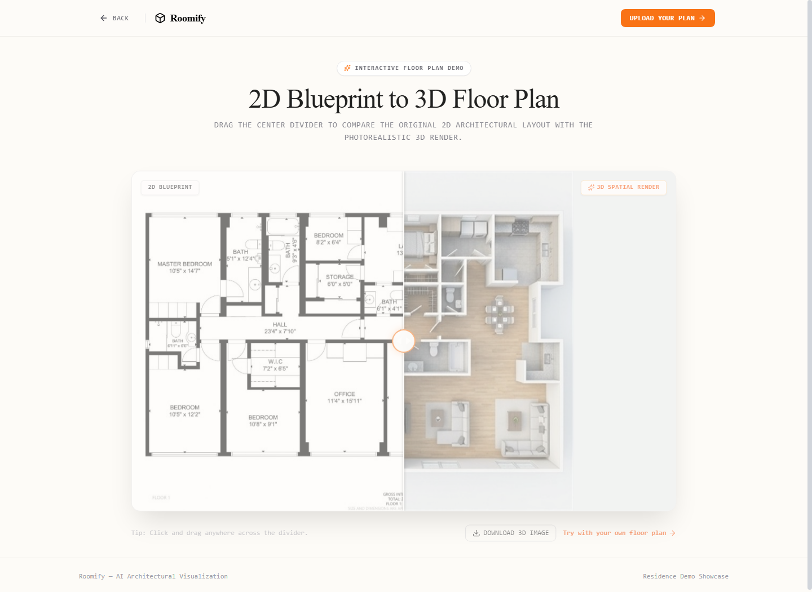
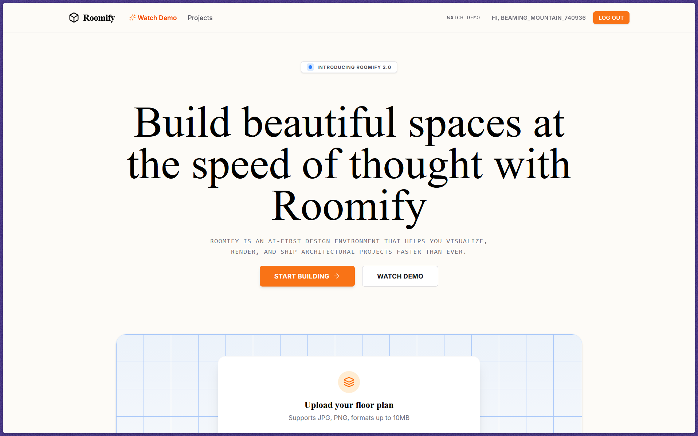

<div align="center">

# 🏛️ Roomify 2.0

### **AI-First Architectural Design & 2D-to-3D Spatial Visualization**

Build beautiful architectural spaces at the speed of thought. Convert raw 2D floor plans and blueprints into photorealistic, daylight-rendered 3D models in seconds.

[](https://roomify-bay-gamma.vercel.app/)
[](https://react.dev/)
[](https://reactrouter.com/)
[](https://tailwindcss.com/)
[](https://www.typescriptlang.org/)
[](https://vitejs.dev/)
[](https://greensock.com/gsap/)
[](https://ai.google.dev/)
[](https://puter.com/)
[](https://www.docker.com/)

🔗 **[Experience Live Website](https://roomify-bay-gamma.vercel.app/)** • 🎚️ **[Try Watch Demo Studio](https://roomify-bay-gamma.vercel.app/demo)** • [Key Features](#-key-features) • [Tech Stack](#-tech-stack--tools) • [Screenshots](#-visual-showcase) • [Getting Started](#-getting-started)

</div>

---

## 🌟 Overview

**Roomify** transforms architectural blueprints into living spaces. Designed for architects, interior designers, real estate visionaries, and homeowners, Roomify pairs generative AI with modern web technologies to bridge the gap between technical 2D blueprints and high-fidelity 3D spatial renders.

Upload any blueprint (`.png`, `.jpg`), and Roomify's spatial diffusion engine parses walls, doorway swings, window boundaries, and furniture icons to generate an orthographic, daylight-lit 3D model.

---

## 📸 Visual Showcase

### 🎚️ Interactive 2D-to-3D Comparison Slider (`/demo`)
Experience the transformation with zero latency. Drag the central divider to inspect structural alignment between the technical blueprint and the generated 3D interior.

<div align="center">
  
</div>

<br/>

### 🏛️ Minimalist Architectural Studio Homepage
Clean, editorial design featuring an AI upload shell, subtle GSAP entrance animations, and responsive layout.

<div align="center">
  
</div>

<br/>

---

## ✨ Key Features

- **⚡ Instant 2D-to-3D Synthesis**: Translates technical blueprints into top-down, photorealistic 3D renders with ray-traced shadows and natural PBR textures in `< 15 seconds`.
- **🎚️ Interactive Comparison Slider**: Butter-smooth before-and-after drag slider powered by `react-compare-slider`, allowing real-time inspection of structural alignment between 2D CAD blueprints and 3D renders.
- **🎭 GSAP & ScrollTrigger Animations**: Subtle parallax scrolling, smooth load sequences, and scroll-triggered element reveals calibrated for architectural elegance with zero clutter.
- **☁️ Serverless Cloud Backend**: Powered by **Puter.js** for passwordless authentication, persistent cloud storage (`puter.fs`), KV database, and public/private project visibility.
- **🎨 Warm Minimalist Aesthetics**: Architectural design system featuring **Instrument Serif** editorial headers, Inter UI sans-serif, technical monospace callouts, and clean paper palettes (`#fdfbf7`).
- **📱 Responsive & Fast**: Full SSR support via React Router v7 and Vite, optimized for retina studio screens, laptops, and mobile viewports.
- **🐳 Containerized & Production Ready**: Pre-configured Dockerfile and optimized production server builds ready for one-click deployment.

---

## 🛠️ Tech Stack & Tools

### **Frontend & Framework**
| Tool / Library | Version | Purpose |
| :--- | :--- | :--- |
|  | `^19.2.8` | Core UI library utilizing modern concurrent rendering and hooks |
|  | `^8.5.0` (v7) | Full-stack framework handling SSR, data loading, and client routing |
|  | `^5.9.3` | Type-safety, architectural domain types, and zero runtime surprises |
|  | `^8.0.3` | Next-generation bundler with instant HMR and environment API |

### **Styling & Animation**
| Tool / Library | Version | Purpose |
| :--- | :--- | :--- |
|  | `^4.2.2` | CSS engine using the latest `@theme` configuration and `@tailwindcss/vite` |
|  | `^3.15.0` | Professional grade animations, parallax scroll depth, and smooth timelines |
|  | `^1.61.0` | Clean, crisp, lightweight SVG icon system |

### **Interactive Visualizer & AI Engine**
| Tool / Library | Version | Purpose |
| :--- | :--- | :--- |
|  | `^4.0.0` | High-performance canvas slider for side-by-side blueprint-to-render inspection |
|  | Multimodal | Generative image-to-image spatial reconstruction via Puter AI |
|  | `^2.6.4` | Serverless cloud authentication, secure file storage, and KV database |

---

## 📐 How It Works

```
   ┌──────────────────┐
   │  2D Floor Plan   │  (CAD Blueprint, Sketch, JPG / PNG)
   └────────┬─────────┘
            │
            ▼
   ┌──────────────────┐
   │  Spatial Prompt  │  Removes technical text, maps door swings,
   │  & Preprocessing │  extrudes wall boundaries & fixtures
   └────────┬─────────┘
            │
            ▼
   ┌──────────────────┐
   │  Gemini Vision   │  Puter AI multimodal generation with
   │    AI Engine     │  raytraced daylighting & physical textures
   └────────┬─────────┘
            │
            ▼
   ┌──────────────────┐
   │  Interactive 3D  │  Full-screen visualizer with compare slider,
   │    Visualizer    │  re-rendering, export, and project sharing
   └──────────────────┘
```

---

## 📂 Project Structure

```
roomify/
├── app/
│   ├── app.css                   # Tailwind v4 theme, fonts, custom scrollbars & rcs styles
│   ├── root.tsx                  # Root layout, Google Fonts (Instrument Serif & Inter), auth
│   ├── routes.ts                 # React Router v7 route definitions
│   └── routes/
│       ├── home.tsx              # Home screen with upload shell, GSAP parallax & projects grid
│       ├── demo.tsx              # Clean interactive 2D vs 3D comparison slider showcase
│       └── visualizer.$id.tsx    # Live project studio: AI generation, re-render, and export
├── components/
│   ├── Navbar.tsx                # Sticky navigation with authentication & demo direct link
│   ├── Upload.tsx                # Drag-and-drop floor plan upload component with validation
│   └── ui/
│       └── Button.tsx            # Neo-minimalist button primitives
├── lib/
│   ├── ai.action.ts              # Gemini AI diffusion pipeline via Puter AI txt2img
│   ├── constants.ts              # System prompts, storage paths, UI parameters
│   ├── puter.action.ts           # Puter.js user auth, project CRUD, and cloud storage
│   ├── puter.hosting.ts          # Public hosting and asset distribution logic
│   └── utils.ts                  # Canvas, base64, URL and string utilities
├── public/
│   ├── demo-assets/
│   │   ├── floorplan-2d.jpg      # Sample 2D CAD floor plan blueprint
│   │   ├── floorplan-3d.jpg      # 3D generated architectural floor plan
│   │   └── floorplan-3d-canvas.jpg # Aligned aspect-ratio canvas for slider precision
│   ├── screenshots/              # Publicly accessible screenshots
│   └── favicon.ico
├── screenshots/                  # High-resolution documentation screenshots
│   ├── demo-slider.png
│   ├── hero.png
│   ├── home-full.png
│   └── visualizer-studio.png
├── Dockerfile                    # Multi-stage production container definition
├── package.json
├── tsconfig.json
└── vite.config.ts                # Vite config with React Router and Tailwind v4 plugins
```

---

## 🚀 Getting Started

### Prerequisites

- **Node.js**: `v20.0.0` or higher
- **npm** (or `pnpm` / `bun`)
- (Optional) **Docker** for containerized execution

### 1. Clone the repository

```bash
git clone https://github.com/your-username/roomify.git
cd roomify
```

### 2. Install dependencies

```bash
npm install
```

### 3. Start local development server

```bash
npm run dev
```

Open [http://localhost:5173](http://localhost:5173) in your browser to experience Roomify.

---

## 🧪 Interactive Demo

To test the 2D-to-3D transformation slider:
1. Visit the live deployment: **[https://roomify-bay-gamma.vercel.app/demo](https://roomify-bay-gamma.vercel.app/demo)**
2. Or click the **"Watch Demo"** button on the home screen hero or in the top navigation.
3. Grab the vertical divider with your mouse or finger and drag left/right to compare the CAD blueprint with the AI 3D spatial render.

---

## 🏗️ Production Build & Deployment

### Build the Application

```bash
npm run build
```

This compiles client and server bundles into the `./build` folder.

### Run Production Server

```bash
npm run start
```

Runs the production server at `http://localhost:3000`.

### Type Checking

```bash
npm run typecheck
```

Runs React Router typegen followed by TypeScript compiler checks.

---

## 🐳 Docker Deployment

Build and run using Docker:

```bash
# 1. Build Docker image
docker build -t roomify .

# 2. Run container on port 3000
docker run -p 3000:3000 roomify
```

The containerized service is production-ready for deployment on **AWS ECS**, **Google Cloud Run**, **Railway**, **Render**, or **Fly.io**.

---

## 🛡️ License

Distributed under the **MIT License**. See `LICENSE` for more information.

<div align="center">
  <sub>Built with ❤️ by Archit Dash • Powered by Google Gemini & Puter</sub>
</div>
